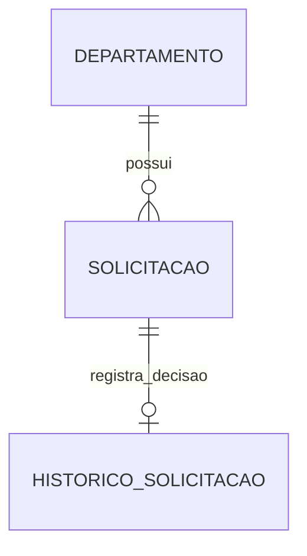

# Gestão de Verbas — API REST

API para gerenciar orçamentos departamentais, solicitações de verba e decisões de aprovação ou rejeição. Desenvolvida em **Java 21 com Spring Boot e PostgreSQL**, com organização por domínio, histórico de decisões e controle transacional para evitar reservas acima do orçamento disponível.

## Navegação

- [Funcionalidades](#funcionalidades)
- [Tecnologias e arquitetura](#tecnologias-e-arquitetura)
- [Como executar](#como-executar)
- [IntelliJ com PostgreSQL local](#intellij-com-postgresql-local)
- [Docker no Ubuntu ou WSL](#docker-no-ubuntu-ou-wsl)
- [IntelliJ com banco no Docker](#intellij-com-banco-no-docker)
- [Configuração](#configuração)
- [Endpoints e exemplos](#endpoints-e-exemplos)
- [Testes](#testes)
- [Solução de problemas](#solução-de-problemas)
- [Escopo e documentação](#escopo-e-documentação)

## Funcionalidades

- Cadastro, listagem e consulta de departamentos com orçamento próprio.
- Abertura de solicitações e consulta com filtros por departamento e status, além de paginação.
- Aprovação com reserva de saldo e rejeição com justificativa obrigatória.
- Histórico de decisões por solicitação, com responsável e data.
- Validação de entradas e respostas de erro padronizadas.
- Controle de concorrência por bloqueio pessimista e transações atômicas.

### Regras de negócio

Uma solicitação começa como `PENDENTE` e pode passar para `APROVADA` ou `REJEITADA`. Uma decisão concluída não pode ser repetida nem revertida pela API.

A aprovação exige saldo suficiente e aumenta o valor comprometido do departamento. Ela representa uma **reserva de orçamento**, sem executar pagamento. Se faltar saldo, a API retorna `409 Conflict`: a solicitação continua pendente e nenhum histórico de decisão é criado.

Valores monetários são positivos, têm no máximo duas casas decimais e não podem exceder `999999999999.99`. O projeto usa `BigDecimal` no Java e `NUMERIC(14,2)` no banco. O saldo disponível corresponde ao orçamento total menos o valor comprometido.

## Tecnologias e arquitetura

| Tecnologia | Papel no projeto |
|---|---|
| Java 21 / Spring Boot 3.5.16 | Aplicação e API REST |
| Spring Data JPA / Hibernate | Persistência e mapeamento das entidades |
| PostgreSQL | Banco relacional; imagem Docker fixada em 16.6 |
| Flyway | Versionamento das tabelas, restrições e índices |
| Jakarta Bean Validation | Validação das requisições |
| JUnit / Testcontainers | Testes unitários e integração com PostgreSQL |
| Maven Wrapper / Docker Compose | Build e execução reproduzíveis |

Os pacotes agrupam as funcionalidades por domínio. Dentro deles, os controllers recebem as requisições, os services executam as regras e os repositories acessam o banco. As exceções são convertidas em respostas HTTP por um handler centralizado.

```text
src/main/java/br/com/gabriel/verbas/
├── departamento/    # Orçamento e saldo dos departamentos
├── solicitacao/     # Criação, consulta, aprovação e rejeição
├── historico/       # Registro e consulta das decisões
└── shared/          # Validação monetária e tratamento de erros

src/main/resources/
├── application.yml
└── db/migration/    # Migrações versionadas pelo Flyway

src/test/            # Testes unitários e de integração
```

A decisão bloqueia o departamento antes de validar e reservar saldo. A reserva, a mudança de status e o histórico pertencem à mesma transação: uma falha impede a confirmação parcial da operação.



## Como executar

Escolha uma das opções abaixo. Execute os comandos na pasta que contém `pom.xml` e `compose.yaml`.

| Opção | Pré-requisitos | Preparação do banco |
|---|---|---|
| IntelliJ + PostgreSQL local | JDK 21, IntelliJ IDEA e PostgreSQL instalado e iniciado | Criar usuário e banco manualmente |
| Aplicação + banco no Docker | Docker Engine ativo e Docker Compose | A imagem do PostgreSQL cria usuário e banco na primeira inicialização do volume |
| IntelliJ + banco no Docker | JDK 21, IntelliJ IDEA, Docker Engine e Compose | O contêiner prepara o banco; o IntelliJ executa a aplicação |

**A aplicação não cria o usuário PostgreSQL nem o database `verbas`.** O Flyway precisa se conectar a um banco existente para criar e atualizar suas tabelas. O Hibernate está configurado com `ddl-auto: validate`, portanto valida a estrutura criada pelas migrações. Se usuário, senha, porta ou banco estiverem incorretos, a inicialização falha, mesmo que algumas mensagens de startup já tenham aparecido no console.

## IntelliJ com PostgreSQL local

### 1. Iniciar o PostgreSQL e confirmar a porta

Inicie o serviço do PostgreSQL. No Windows, ele pode ser localizado no aplicativo **Serviços**, com um nome como `postgresql-x64-18`.

A porta usual do PostgreSQL é `5432`; o padrão desta aplicação é `5433`. **Não é necessário mudar a porta do servidor:** configure `DB_URL` com a porta em que ele já está atendendo. Os exemplos desta seção usam `5432`. Se o seu servidor usa `5433`, substitua a porta em todos os comandos e na configuração do IntelliJ.

### 2. Criar o usuário e o banco

No PowerShell do Windows, conecte como administrador. O caminho abaixo considera PostgreSQL 18; adapte à versão instalada:

```powershell
& 'C:\Program Files\PostgreSQL\18\bin\psql.exe' -h 127.0.0.1 -p 5432 -U postgres -d postgres -W
```

Informe a senha do usuário administrador `postgres`. Dentro do terminal do **psql**, execute os comandos abaixo, um por vez:

```sql
CREATE ROLE verbas WITH LOGIN;
```

Defina a senha do novo usuário com o comando interativo do psql:

```text
\password verbas
```

Digite e confirme uma senha de sua escolha. Em seguida, crie o banco com esse usuário como proprietário:

```sql
CREATE DATABASE verbas OWNER verbas;
```

Saia com `\q`. Essa preparação é feita uma única vez por instalação. Se o usuário já existir, não repita `CREATE ROLE`; use `\password verbas` para redefinir sua senha, se necessário. Se o banco já existir, preserve-o e confira seu proprietário e as permissões.

**A senha de `postgres` não é automaticamente a senha de `verbas`.** São usuários distintos. A aplicação deve receber a senha definida para `verbas`.

Teste a conexão antes de abrir a aplicação:

```powershell
& 'C:\Program Files\PostgreSQL\18\bin\psql.exe' -h 127.0.0.1 -p 5432 -U verbas -d verbas -W
```

Se aparecer o prompt `verbas=>`, as credenciais permitem acessar o banco. Saia com `\q`.

Referência: [comandos e conexão pelo psql](https://www.postgresql.org/docs/18/app-psql.html).

### 3. Configurar e executar no IntelliJ

1. Abra a pasta do projeto e importe o `pom.xml` como projeto Maven.
2. Configure o **Project SDK** e o JDK da execução como **Java 21**.
3. Abra `VerbasApplication` e crie uma configuração de execução para sua função `main`.
4. Entre em **Run → Edit Configurations** e selecione a configuração da aplicação.
5. Se **Environment variables** não aparecer, habilite-o em **Modify options**. Abra o editor desse campo e adicione uma variável por linha:

| Nome | Valor para PostgreSQL local na porta 5432 |
|---|---|
| `DB_URL` | `jdbc:postgresql://127.0.0.1:5432/verbas` |
| `DB_USERNAME` | `verbas` |
| `DB_PASSWORD` | A senha que você definiu para o usuário `verbas` |
| `SERVER_ADDRESS` | `127.0.0.1` |

Esses valores pertencem a **Environment variables**, não a **Active profiles**, **VM options** ou **Program arguments**. O texto da célula de senha é uma orientação: substitua-o pela sua senha real. Não compartilhe uma configuração de execução contendo essa senha.

Salve e execute `br.com.gabriel.verbas.VerbasApplication`. Aguarde a mensagem `Started VerbasApplication`. Nessa inicialização, o Flyway cria as tabelas no banco preparado anteriormente.

Referência: [configuração de execução Spring Boot no IntelliJ IDEA](https://www.jetbrains.com/help/idea/run-debug-configuration-spring-boot.html).

### Alternativa pelo terminal

Com JDK 21 configurado em `JAVA_HOME`, no PowerShell e na pasta do projeto:

```powershell
$env:DB_URL = 'jdbc:postgresql://127.0.0.1:5432/verbas'
$env:DB_USERNAME = 'verbas'
$env:DB_PASSWORD = 'SUBSTITUA_PELA_SENHA_DE_VERBAS'
$env:SERVER_ADDRESS = '127.0.0.1'
.\mvnw.cmd spring-boot:run
```

Substitua o exemplo de senha antes de executar. As variáveis desse terminal valem para processos iniciados por ele; configure também a execução do IntelliJ se for iniciar pela IDE.

## Docker no Ubuntu ou WSL

Com o Docker Engine ativo dentro do Ubuntu/WSL, não é necessário abrir o Docker Desktop do Windows. Entre na pasta do projeto pelo terminal Linux; arquivos no disco `C:` ficam acessíveis em `/mnt/c/`.

Confirme as ferramentas:

```bash
docker info
docker compose version
```

Os comandos abaixo usam o plugin `docker compose`. Se o ambiente tiver apenas `docker-compose`, use essa forma no lugar de `docker compose`. Para instalar o plugin, siga a [documentação oficial do Docker](https://docs.docker.com/compose/install/linux/), de acordo com os repositórios da sua distribuição.

### Preparar e iniciar

Em um clone novo, copie o exemplo e edite a senha:

```bash
cp .env.example .env
nano .env
```

Defina `POSTGRES_PASSWORD` com uma senha local. Se `.env` já estiver configurado, preserve-o. Esse arquivo é ignorado pelo Git.

```bash
docker compose -f compose.yaml --profile app up --build -d
docker compose -f compose.yaml --profile app ps
docker compose -f compose.yaml logs --tail=100 app
```

Na primeira inicialização com volume vazio, a imagem do PostgreSQL cria o usuário `verbas` e o banco `verbas`. Depois, o Flyway cria as tabelas. **Alterar `POSTGRES_PASSWORD` no `.env` não redefine a senha de um banco que já possui dados no volume.** Esse comportamento pertence à [imagem oficial do PostgreSQL](https://hub.docker.com/_/postgres).

| Serviço | Acesso a partir do Windows/host |
|---|---|
| API | `http://localhost:8080` |
| PostgreSQL | `127.0.0.1:5433`, banco `verbas`, usuário `verbas` |

Dentro da rede do Compose, a aplicação acessa o banco por `db:5432`. A porta `5433` é a publicação para ferramentas externas, como psql ou o cliente de banco do IntelliJ. PostgreSQL não é acessado pelo navegador.

### Logs, parada e atualização do código

```bash
# Acompanhar a aplicação; Ctrl+C encerra apenas esta visualização
docker compose -f compose.yaml logs -f app

# Consultar o banco
docker compose -f compose.yaml logs --tail=100 db

# Encerrar os serviços preservando o volume de dados
docker compose -f compose.yaml --profile app down

# Subir novamente, incluindo alterações no código Java
docker compose -f compose.yaml --profile app up --build -d
```

Para atualizar somente a aplicação enquanto o banco continua ativo:

```bash
docker compose -f compose.yaml --profile app up --build -d app
```

`restart` apenas reinicia o contêiner existente; use `--build` após alterar Java ou dependências. Não acrescente `-v` ao `down` se deseja preservar o banco: essa opção remove o volume de dados.

## IntelliJ com banco no Docker

Prepare `.env` como na seção anterior e, no Ubuntu/WSL, inicie apenas o banco:

```bash
docker compose -f compose.yaml up -d db
```

No IntelliJ, use as instruções de execução local, com estes ajustes:

- `DB_URL=jdbc:postgresql://127.0.0.1:5433/verbas`
- `DB_USERNAME=verbas`
- `DB_PASSWORD` igual à senha de `verbas` no contêiner, definida por `POSTGRES_PASSWORD` na primeira inicialização do volume.

**O Spring Boot deste projeto não carrega `.env` automaticamente.** Esse arquivo é usado pelo Compose; a execução pela IDE precisa receber as variáveis no IntelliJ.

Se o contêiner `app` já estiver rodando, pare-o antes de iniciar a aplicação pela IDE, para liberar a porta `8080`:

```bash
docker compose -f compose.yaml stop app
```

Nesse modo, alterações no Java exigem reiniciar a aplicação pelo IntelliJ. Os logs da API ficam no console **Run**, enquanto os logs do banco continuam no Docker.

## Configuração

| Variável | Padrão | Uso |
|---|---|---|
| `DB_URL` | `jdbc:postgresql://localhost:5433/verbas` | Endereço JDBC do banco; ajuste à porta real |
| `DB_USERNAME` | `verbas` | Usuário de conexão da aplicação |
| `DB_PASSWORD` | Sem padrão; obrigatória | Senha desse usuário |
| `SERVER_ADDRESS` | `127.0.0.1` | Interface de escuta da API; o Compose define `0.0.0.0` dentro do contêiner |
| `POSTGRES_PASSWORD` | Sem padrão; obrigatória no Compose | Inicializa a senha no volume novo e fornece `DB_PASSWORD` ao serviço `app` |

A API usa a porta `8080`. Evite executar a API simultaneamente no Docker e no IntelliJ nessa porta. Da mesma forma, não publique o banco Docker na porta `5433` se ela já estiver ocupada por uma instalação local do PostgreSQL.

## Endpoints e exemplos

URL base: `http://localhost:8080`. A aplicação fornece uma API, sem página inicial ou Swagger configurado. Um `404` em `/` não significa, por si só, falha na inicialização. Use o Postman ou os exemplos em [docs/api.http](docs/api.http).

| Método | Endpoint | Operação | Sucesso |
|---|---|---|---|
| `POST` | `/departamentos` | Criar departamento | `201` |
| `GET` | `/departamentos` | Listar departamentos | `200` |
| `GET` | `/departamentos/{id}` | Consultar departamento | `200` |
| `POST` | `/departamentos/{id}/solicitacoes` | Abrir solicitação no departamento | `201` |
| `GET` | `/solicitacoes` | Listar solicitações com filtros e paginação | `200` |
| `GET` | `/solicitacoes/{id}` | Consultar solicitação | `200` |
| `POST` | `/solicitacoes/{id}/aprovar` | Aprovar e reservar saldo | `200` |
| `POST` | `/solicitacoes/{id}/rejeitar` | Rejeitar com justificativa | `200` |
| `GET` | `/solicitacoes/{id}/historico` | Consultar decisões da solicitação | `200` |

A listagem de solicitações aceita `departamentoId`, `status`, `page` e `size`. A página começa em `0`, o tamanho padrão é `20` e o máximo é `100`. Os status são `PENDENTE`, `APROVADA` e `REJEITADA`.

### Primeiro fluxo pelo Postman

Nas requisições `POST`, selecione **Body → raw → JSON**, com `Content-Type: application/json`.

**1. Criar departamento:** `POST /departamentos`

```json
{
  "nome": "Engenharia",
  "orcamentoTotal": 10000.00
}
```

**2. Abrir solicitação:** `POST /departamentos/{idDepartamento}/solicitacoes`

```json
{
  "descricao": "Compra de equipamentos",
  "valor": 7000.00
}
```

**3. Aprovar:** `POST /solicitacoes/{idSolicitacao}/aprovar`

```json
{
  "responsavel": "Gabriel"
}
```

Substitua os marcadores pelos IDs retornados em cada criação. **O ID do departamento e o ID da solicitação identificam registros diferentes**, mesmo quando os números coincidem.

Consulte `GET /departamentos/{idDepartamento}` para conferir o saldo disponível de `3000.00` e `GET /solicitacoes/{idSolicitacao}/historico` para ver a decisão. Uma segunda solicitação de `7000.00` não poderá ser aprovada nesse departamento por falta de saldo; ela continuará pendente.

Para rejeitar uma solicitação ainda pendente, use `POST /solicitacoes/{idSolicitacao}/rejeitar`:

```json
{
  "responsavel": "Gabriel",
  "justificativa": "Investimento adiado para outro período"
}
```

### Respostas de erro e histórico

| Código | Significado |
|---|---|
| `400 Bad Request` | Entrada inválida, como valor negativo, mais de duas casas decimais ou justificativa vazia |
| `404 Not Found` | Recurso ou rota inexistente |
| `409 Conflict` | Saldo insuficiente, solicitação já decidida ou conflito de concorrência |

O histórico pertence à **solicitação**: `/departamentos/{id}/historico` não existe. Uma solicitação existente e ainda sem decisão retorna `200` com `[]` em seu histórico; um ID de solicitação inexistente retorna `404`.

## Testes

O Maven Wrapper acompanha o projeto; não é necessário instalar Maven separadamente. Os comandos locais exigem JDK 21.

| Verificação | Windows / PowerShell | Linux |
|---|---|---|
| Unitários | `.\mvnw.cmd test` | `sh ./mvnw test` |
| Unitários e integração | `.\mvnw.cmd -Pintegration verify` | `sh ./mvnw -Pintegration verify` |

Os testes de integração exigem acesso ao Docker e usam PostgreSQL temporários criados pelo Testcontainers. No Ubuntu/WSL, também é possível executar a suíte em um contêiner Maven, sem instalar o JDK no Linux:

```bash
sh scripts/testar-wsl.sh
```

A suíte cobre validação monetária, transições de status, saldo insuficiente, decisões duplicadas, rollback, aprovações concorrentes e migrações com preservação de dados. Os bancos dos testes são isolados do volume usado pela aplicação.

Para uma demonstração com a API já iniciada, execute no PowerShell:

```powershell
powershell -ExecutionPolicy Bypass -File scripts\demo.ps1
```

A demonstração cria seus próprios registros, aprova uma solicitação e verifica que outra aprovação sem saldo retorna `409`. Os registros ficam no banco da aplicação.

## Solução de problemas

| Sintoma | O que verificar |
|---|---|
| `Connection refused` / SQL State `08001` | Serviço PostgreSQL iniciado, host correto e porta real na `DB_URL`. A conexão ainda não chegou à autenticação. |
| `password authentication failed` / SQL State `28P01` | Teste o mesmo host, porta, usuário e banco pelo psql. Confirme a existência do usuário e a senha dele; a senha de `postgres` não é herdada por `verbas`. |
| `role "verbas" does not exist` | Crie o usuário na mesma instância do PostgreSQL que a aplicação acessa, conforme o passo a passo local. |
| `database "verbas" does not exist` | Crie `verbas` com proprietário `verbas` antes de iniciar o Spring Boot. O Flyway não cria esse database. |
| `.env` preenchido, mas erro de senha no IntelliJ | Configure `DB_PASSWORD` nas variáveis da execução da IDE. O projeto não importa `.env` automaticamente. |
| Senha alterada no `.env`, mas banco Docker recusa conexão | O volume existente mantém a senha anterior. Redefina a senha do usuário no PostgreSQL e alinhe as configurações; não apague o volume como correção de senha. |
| `Port 8080 was already in use` | Confira se outra execução da API está ativa no IntelliJ ou no Docker. |
| Porta `5433` ocupada | Confira se PostgreSQL local e Docker estão tentando usar a mesma porta do host. |
| `404` em `http://localhost:8080/` | Não existe rota inicial. Teste um endpoint documentado, como `GET /solicitacoes`. |
| “Solicitação já foi decidida” | Consulte `GET /solicitacoes/{id}` e confira o ID usado no Postman. Uma falha por saldo insuficiente não rejeita automaticamente a solicitação. |
| `docker: unknown command: docker compose` | O plugin não está disponível nesse ambiente. Verifique `docker-compose --version` ou instale o plugin seguindo a documentação oficial. |
| `KeyError: 'ContainerConfig'` no Compose 1.29.2 | Falha do Compose antigo ao recriar o contêiner; use o procedimento abaixo ou migre para o plugin moderno. |

Para contornar a falha `ContainerConfig` no ambiente legado, remova somente o contêiner da aplicação e crie-o novamente, no Ubuntu/WSL:

```bash
docker-compose -f compose.yaml rm -sf app
docker-compose -f compose.yaml --profile app up --build -d app
docker-compose -f compose.yaml logs --tail=100 app
```

Esse procedimento preserva o serviço do banco e seu volume. A solução de manutenção é atualizar o Compose; a recriação acima é uma alternativa para o ambiente legado.

## Escopo e documentação

O projeto é uma API de estudo e portfólio. O escopo atual não inclui autenticação, autorização, edição ou exclusão de registros, pagamentos, renovação anual de orçamento nem interface gráfica. O campo `responsavel` é informado pelo cliente, sem verificação de identidade. O histórico registra decisões da aplicação, mas não impede alterações feitas por quem tem acesso direto ao banco.

- [Requisitos e regras de negócio](requisitos.md)
- [Decisões de arquitetura](docs/arquitetura.md)
- [Exemplos de requisições HTTP](docs/api.http)
- [Consultas SQL para conferência](docs/consultas.sql)
- [Roteiro de estudo por módulo](docs/roteiro-estudo.md)
