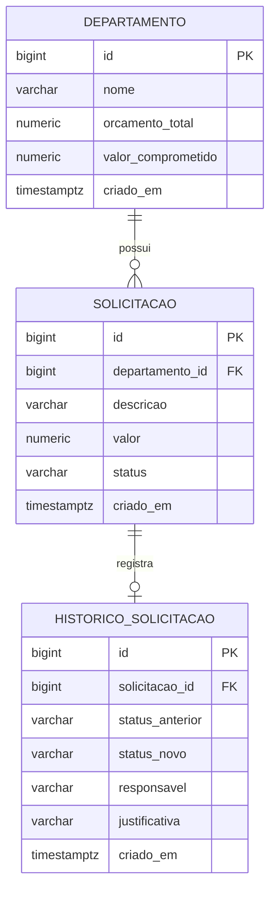

# gestao-verbas — API REST de Gestão de Verbas

API REST modular em **Java 21** com **Spring Boot 3.5.16** para gestão de orçamentos departamentais: criação de departamentos, abertura de solicitações de verba e aprovação/rejeição com reserva de saldo, histórico de decisões e concorrência controlada por bloqueio pessimista.

> **Proveniência de desenvolvimento:** partes deste projeto foram delegadas durante o desenvolvimento ao NVIDIA NIM (modelo `z-ai/glm-5.3`, referência: https://docs.api.nvidia.com/nim/reference/z-ai-glm-5-3-infer) e revisadas localmente. **O runtime da aplicação não faz nenhuma chamada a IA** — a API é um serviço Spring Boot comum.

Documentação complementar (já fornecida no repositório):
- [`docs/ambiente-wsl.md`](docs/ambiente-wsl.md) — execução no Ubuntu WSL desta máquina.
- [`docs/validacao.md`](docs/validacao.md) — testes e demonstração executados.
- [`docs/delegacao-nim.md`](docs/delegacao-nim.md) — rastreabilidade da geração e revisão.
- [`docs/arquitetura.md`](docs/arquitetura.md) — decisões de arquitetura e camadas.
- [`requisitos.md`](requisitos.md) — requisitos de negócio detalhados.
- [`docs/api.http`](docs/api.http) — exemplos de requisições HTTP.
- [`docs/consultas.sql`](docs/consultas.sql) — consultas SQL de verificação.
- [`docs/roteiro-estudo.md`](docs/roteiro-estudo.md) — roteiro de estudo por módulo.
- [`scripts/demo.ps1`](scripts/demo.ps1) — demonstração automatizada de 5 minutos.

---

## Requisitos do sistema

- **JDK 21** para execução local. Ao usar Docker, Java e Maven já estão na imagem.
- **Docker Engine no Ubuntu WSL2** (ambiente validado nesta máquina). O launcher Docker Desktop do Windows não é necessário. Veja [ambiente WSL](docs/ambiente-wsl.md).
- **Windows 10/11** com PowerShell 5.1 ou PowerShell 7 (equivalentes Linux indicados).
- Requisitos oficiais do Spring Boot 3.5: https://docs.spring.io/spring-boot/3.5/system-requirements.html

---

## Visão geral do domínio

| Entidade | Campos | Observações |
|---|---|---|
| `departamento` | `id`, `nome`, `orcamento_total`, `valor_comprometido`, `criado_em` | Orçamento total positivo; `valor_comprometido` inicia em 0. |
| `solicitacao` | `id`, `departamento_id`, `descricao`, `valor`, `status`, `criado_em` | Status: `PENDENTE`, `APROVADA`, `REJEITADA`. Sem edição/exclusão. |
| `historico_solicitacao` | `id`, `solicitacao_id`, `status_anterior`, `status_novo`, `responsavel`, `justificativa`, `criado_em` | Trilha de decisões. Rejeição exige justificativa. |

Dinheiro: `BigDecimal` / `NUMERIC(14,2)`, positivo, máximo `999999999999.99`; valores com mais de 2 casas decimais são rejeitados (HTTP 400). Timestamps: `Instant` / `TIMESTAMPTZ` (UTC).

### Diagrama Entidade-Relacionamento



### Regras de negócio (resumo)

1. **Orçamento positivo:** `orcamentoTotal` deve ser > 0 e `valorComprometido` começa em 0.
2. **Valores monetários:** positivos, no máximo `999999999999.99`, no máximo 2 casas decimais; caso contrário, HTTP 400.
3. **Aprovação só de pendentes:** apenas solicitações `PENDENTE` podem ser decididas; segunda decisão gera HTTP 409.
4. **Saldo suficiente:** aprovação exige `valorComprometido + valor <= orcamentoTotal`; saldo insuficiente gera HTTP 409.
5. **Aprovar reserva, não paga:** aprovação incrementa `valorComprometido` (reserva); não há pagamento/baixa.
6. **Rejeição exige justificativa:** campo `justificativa` obrigatório na rejeição.
7. **Decisões atômicas e concorrentes:** bloqueio pessimista do departamento primeiro, depois carregamento da solicitação; aprovação e rejeição seguem o mesmo protocolo. Conflito de bloqueio/tempo gera HTTP 409.

Sem endpoints de edição ou exclusão de registros; o histórico pode ser alterado por quem possui acesso direto ao banco. Sem autenticação: `responsavel` é um nome fictício informado pelo cliente; quando houver autenticação futura, o responsável virá de contexto confiável do servidor, não do corpo da requisição.

---

## Rotas da API

| Método | Rota | Corpo | Sucesso | Erros |
|---|---|---|---|---|
| POST | `/departamentos` | `{"nome":..., "orcamentoTotal":...}` | 201 + `Location` | 400 |
| GET | `/departamentos/{id}` | — | 200 | 404 |
| POST | `/departamentos/{id}/solicitacoes` | `{"descricao":..., "valor":...}` | 201 + `Location` | 400, 404 |
| GET | `/solicitacoes?departamentoId=&status=&page=&size=` | — (size máx. 100) | 200 | 400 |
| GET | `/solicitacoes/{id}` | — | 200 | 404 |
| POST | `/solicitacoes/{id}/aprovar` | `{"responsavel":...}` | 200 | 400, 404, 409 |
| POST | `/solicitacoes/{id}/rejeitar` | `{"responsavel":..., "justificativa":...}` | 200 | 400, 404, 409 |
| GET | `/solicitacoes/{id}/historico` | — | 200 | 404 |

DTOs de resposta:
- Departamento: `id`, `nome`, `orcamentoTotal`, `valorComprometido`, `saldoDisponivel`, `criadoEm`.
- Solicitação: `id`, `departamentoId`, `descricao`, `valor`, `status`, `criadoEm`.

---

## Estrutura do projeto

```
gestao-verbas/
├── .env.example
├── compose.yaml
├── Dockerfile
├── mvnw / mvnw.cmd          # Maven Wrapper 3.9.16 (gerado oficialmente)
├── requisitos.md
├── pom.xml                   # Spring Boot parent 3.5.16
├── src/
│   ├── main/
│   │   ├── java/br/com/gabriel/verbas/
│   │   │   ├── departamento/   # controller, service, repository, entity, dto
│   │   │   ├── solicitacao/   # controller, service, repository, entity, dto
│   │   │   ├── historico/     # entidade, repository, registro de decisões
│   │   │   └── shared/        # exceções, handlers, validação monetária
│   │   └── resources/
│   │       ├── application.yml
│   │       └── db/migration/  # V1__criar_estrutura.sql, V2__adicionar_indices.sql
│   └── test/                  # testes unitários e de integração (Testcontainers)
├── docs/
│   ├── arquitetura.md
│   ├── api.http
│   ├── consultas.sql
│   └── roteiro-estudo.md
└── scripts/
    └── demo.ps1
```

Pacotes de funcionalidade (feature packages): `departamento`, `solicitacao`, `historico`, `shared` — cada módulo agrupa suas entidades, repositórios, serviços e controllers; `shared` concentra exceções de domínio, handlers globais e validação monetária comum.

### Arquitetura (resumo)

- **Controller** (web): valida entrada via Bean Validation, delega ao serviço, mapeia exceções de domínio para HTTP 400/404/409.
- **Service** (domínio): regras de negócio, transação (`@Transactional`), protocolo de bloqueio pessimista (bloqueia departamento → carrega solicitação → valida → reserva saldo e muda situação → flush → grava histórico → commit).
- **Repository** (persistência): Spring Data JPA; bloqueio pessimista via lock no repositório de departamentos.
- **Migrations:** Flyway (`V1__criar_estrutura.sql`, `V2__adicionar_indices.sql`); JPA configurado com `validate` e `open-in-view: false`.
- **Banco:** PostgreSQL 16.6 (alpine) via Docker; dinheiro `NUMERIC(14,2)`, tempo `TIMESTAMPTZ`.

Detalhes completos em [`docs/arquitetura.md`](docs/arquitetura.md).

---

## Como executar (Docker no Ubuntu WSL)

Na máquina de Gabriel, comece pelo [passo a passo do WSL](docs/ambiente-wsl.md). Os comandos Docker desta seção devem ser executados dentro do Ubuntu. O comando `docker-compose` é o disponível nesse ambiente; em instalações com Compose v2, use `docker compose -f compose.yaml`.

Nesta cópia local, `.env` já foi criado com uma senha aleatória durante a validação; preserve-o. Em um clone novo, copie o exemplo conforme abaixo.

1. Copie o exemplo de variáveis e edite a senha:

   ```powershell
   Copy-Item .env.example .env
   notepad .env
   # Linux: cp .env.example .env && nano .env
   ```

   Em `.env`, substitua o placeholder de `POSTGRES_PASSWORD` pela sua senha local desejada (não use a literal do exemplo em produção; aqui é um ambiente local de estudo).

2. Suba a aplicação completa (banco + API):

   ```powershell
   docker-compose -f compose.yaml --profile app up --build -d
   # Linux: docker-compose -f compose.yaml --profile app up --build -d
   ```

3. A API estará em **http://localhost:8080** (endereço vinculado a `127.0.0.1`).

4. Para encerrar **preservando os dados** (volume nomeado):

   ```powershell
   docker-compose -f compose.yaml down
   ```

   > Não é necessário nem recomendado remover o volume por padrão. `docker-compose -f compose.yaml down` sem `-v` mantém o volume nomeado do PostgreSQL; os dados persistem entre execuções.

O serviço `app` é opcional (perfil `app`); o serviço `db` usa `postgres:16.6-alpine` com porta hospedeira **5433** → interna 5432 e volume nomeado.

## Como executar (Java local — alternativa)

1. Confirme **JDK 21** no `JAVA_HOME`:

   ```powershell
   java -version   # deve indicar 21
   # Linux: java -version
   ```
2. Suba apenas o banco:

   ```powershell
   docker-compose -f compose.yaml up -d db
   ```

3. Configure as variáveis de ambiente. **Atenção: o Spring não carrega `.env` automaticamente** — defina `DB_PASSWORD` com a MESMA senha que você colocou em `POSTGRES_PASSWORD` no `.env`:

   ```powershell
   $env:DB_PASSWORD = "sua-senha-do-.env"
   # DB_USERNAME padrão: verbas
   # DB_URL padrão: jdbc:postgresql://localhost:5433/verbas
   # Linux: export DB_PASSWORD="sua-senha-do-.env"
   ```

4. Execute:

   ```powershell
   .\mvnw.cmd spring-boot:run
   # Linux: ./mvnw spring-boot:run
   ```

A API continua em http://localhost:8080. Endpoints são locais e **sem autenticação** (protótipo de estudo).

---

## Testes

**No ambiente de Gabriel:** execute `sh scripts/testar-wsl.sh` no Ubuntu. Os comandos Maven diretos abaixo pressupõem Java e acesso ao Docker no mesmo ambiente.

> **Validação em 05/10/2026:** 33 testes aprovados, zero falhas, erros ou testes ignorados: 9 unitários, 22 de API/concorrência/rollback e 2 de migrations. Executados no Docker do Ubuntu WSL com PostgreSQL 16.6. Veja [evidências](docs/validacao.md).

- **Testes unitários** (sem Docker):

  ```powershell
  .\mvnw.cmd test
  # Linux: ./mvnw test
  ```

- **Testes de integração** (requer Docker em execução; falham se o Docker não estiver disponível — comportamento intencional):

  ```powershell
  .\mvnw.cmd -Pintegration verify
  # Linux: ./mvnw -Pintegration verify
  ```

  Usam **Testcontainers 1.21.3** com imagem `postgres:16.6-alpine`: cada execução cria contêineres PostgreSQL isolados e descartáveis — **nunca tocam nos dados locais** do volume nomeado.

### Unitários × Integração

- **Unitários** validam regras de negócio isoladas (validação monetária, transições de status, cálculo de saldo) diretamente nas entidades e no validador monetário. Não provam comportamento real do banco.
- **Integração** provam o que só o banco real garante: rollback transacional, bloqueio pessimista sob concorrência, constraints de schema e preservação de dados entre migrações.

Cenários verificados pelos testes de integração:
1. Aprovação com saldo insuficiente → HTTP 409 e saldo intacto.
2. Decisão duplicada (aprovar duas vezes, ou aprovar após rejeitar) → HTTP 409.
3. Rejeição sem justificativa → HTTP 400.
4. Falha antes da gravação do histórico → nada é persistido (atomicidade/rollback).
5. Duas solicitações concorrentes de 7000 com orçamento 10000 → exatamente uma aprovação, uma HTTP 409 (bloqueio pessimista).
6. Entradas de API inválidas (valor negativo, 3 casas decimais, campos ausentes) → HTTP 400.
7. Constraints do banco (FK, NUMERIC(14,2), status permitido) respeitadas.
8. Migrações V1 → V2 preservam dados existentes.
A persistência após reinício da API também foi verificada separadamente; os dados e o histórico original permaneceram iguais.

---

## Demonstração de 5 minutos

Com a API em execução, rode o script de demonstração (não apaga dados existentes; cria dados próprios):

```powershell
powershell -ExecutionPolicy Bypass -File scripts\demo.ps1
# PowerShell 7: pwsh -File scripts/demo.ps1
# Linux: pwsh -File scripts/demo.ps1
```

O script: cria departamento com orçamento 10000; abre duas solicitações de 7000; aprova a primeira; consulta saldo e histórico; tenta aprovar a segunda e **espera HTTP 409** (saldo insuficiente), falhando explicitamente se a aprovação inesperadamente ocorrer. Veja também [`docs/api.http`](docs/api.http) para exemplos manuais.

---

## Git e publicação

O repositório local já está inicializado na branch `main`, com commits por etapa. Consulte `git log --oneline`. Ainda não há remoto configurado.

Para publicar, **crie você mesmo** um repositório vazio no GitHub e use a URL fornecida por você (não há remote inventado aqui):

```powershell
git remote add origin <URL_DO_REPOSITORIO>
git push -u origin main
```

---

## Limitações e trabalho futuro (separação clara)

**Limitações atuais (intencionais):**
- Sem autenticação/autorização; `responsavel` é texto livre do cliente e **não é verificado**.
- Histórico **não é à prova de adulteração por DBA** — qualquer pessoa com acesso direto ao banco pode alterar linhas; a trilha é auditoria de aplicação, não criptográfica.
- Sem edição/exclusão de registros (por design).
- Sem pagamento/baixa de verbas (aprovar = reservar).
- Sem renovação anual de orçamento.
- Sem frontend, pagamentos, nuvem ou microsserviços — aplicação local única de estudo.

**Futuro (fora do escopo atual):**
- Autenticação: o responsável pela decisão virá de **contexto confiável do servidor** (ex.: principal autenticado), não do corpo da requisição.
- Trilha de auditoria reforçada (append-only a nível de banco, hashes encadeados ou tabela imutável por permissões).
- Relatórios, frontend e demais extensões.

---

## Licença e uso

Projeto local de estudo. Uso educacional.
