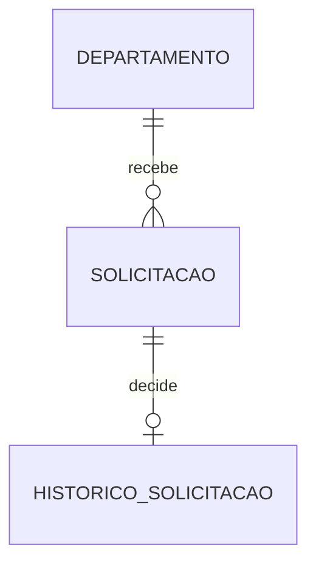

# Decisões de arquitetura

## Estrutura

Monólito modular por domínio: departamento, solicitacao, historico e erros compartilhados. Controllers recebem DTOs e validam entrada; services coordenam casos de uso; repositories acessam o banco. Entidades encapsulam regras e não são serializadas na API. Injeção por construtor, sem Lombok.

Java 21, Spring Boot 3.5.16, Maven, JPA, Bean Validation, PostgreSQL 16 e Flyway. A versão do Spring foi conferida na documentação oficial e suporta Java 21. Flyway cria o esquema e JPA apenas valida. V1 define estrutura; V2 adiciona índices. Migrations compartilhadas não devem ser reescritas.

## Concorrência e transações

Aprovar e rejeitar seguem a mesma ordem: buscar somente ID do departamento, bloquear sua linha com PESSIMISTIC_WRITE, então carregar o pedido e validar a situação. O primeiro acesso não deve materializar o pedido no cache JPA, evitando situação antiga após esperar o bloqueio. A transação mantém a reserva, situação e histórico juntos. O bloqueio de departamento serializa decisões daquele orçamento; departamentos diferentes continuam independentes.

O comprometido é redundância deliberada da soma aprovada. SQL de reconciliação deve conferir essa igualdade. CHECK não verifica somas entre tabelas. Usamos apenas uma estratégia de concorrência nesta versão.

## Modelo

Cada pedido admite uma decisão terminal neste escopo. A unicidade do histórico por solicitação reforça isso. Não existe remoção em cascata. Um futuro fluxo de reabertura exigirá migration e revisão desta cardinalidade.

## Delegação e revisão

Geração de código delegada à API oficial NVIDIA NIM, modelo z-ai/glm-5.3, conforme AGENTS.md do diretório pai. Arquitetura, revisão e validação feitas pelo agente principal. Credencial lida do ambiente somente no processo de delegação; a aplicação não depende de IA. Evidências de validação serão documentadas após executar os testes.
